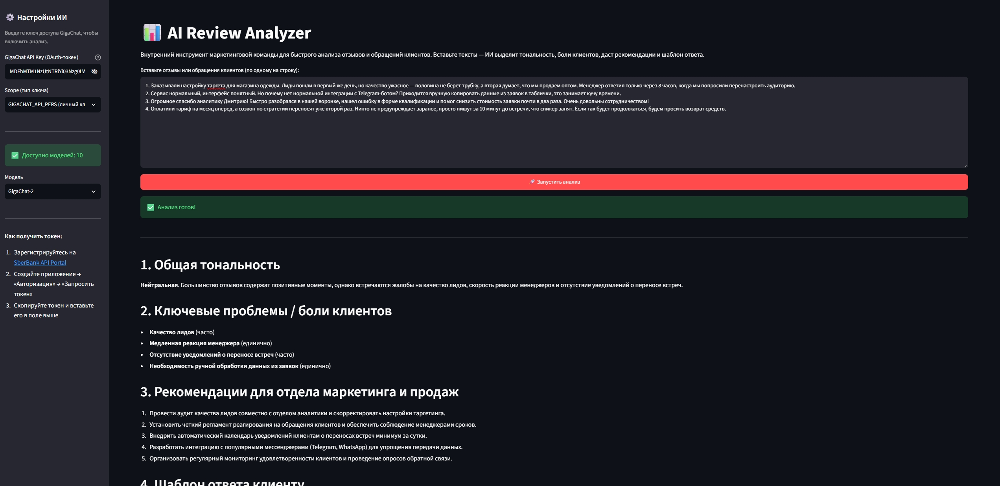

# 📊 AI Review Analyzer


Внутренний AI-инструмент маркетинговой команды для оперативного анализа отзывов и обращений клиентов. Вставьте пачку текстов — и получите структурированный отчёт: тональность, боли клиентов, рекомендации и готовый шаблон ответа.

---

## 📸 Скриншот



---

## 🎯 Возможности

| Возможность | Описание |
| --- | --- |
| **Анализ тональности** | Классификация общего фона отзывов: позитивная / нейтральная / негативная с обоснованием |
| **Определение болей** | Выделение ключевых проблем клиентов с оценкой частотности (часто / иногда / единично) |
| **Рекомендации** | 3–5 конкретных действий для отделов маркетинга и продаж |
| **Шаблоны ответов** | Готовый вежливый ответ клиенту, который можно отправлять без доработки |
| **Выбор модели и scope** | Автоподбор моделей из API GigaChat под ваш токен и тип ключа |

Ответ генерируется на русском языке в формате Markdown и отображается сразу в интерфейсе.

---

## 🛠 Стек

- **Python 3.10+**
- **Streamlit** — интерактивный веб-интерфейс
- **GigaChat API** (`gigachat`) — LLM от Сбера (OpenAI-совместимый API)
- **HTTP** — `verify_ssl_certs=False` для работы с сертификатом GigaChat

---

## ⚡ Быстрый старт

### 1. Установка зависимостей

```bash
git clone https://github.com/leyylin/ai-review-analyzer.git
cd ai-review-analyzer
python -m venv .venv
```

Активация окружения:

```bash
# Windows
.venv\Scripts\activate

# macOS / Linux
source .venv/bin/activate
```

```bash
pip install -r requirements.txt
```

### 2. Получение API-ключа GigaChat

1. Зарегистрируйтесь на [SberBank API Portal](https://developers.sberbank.ru).
2. Создайте приложение → вкладка **«Авторизация»** → **«Запросить токен»**.
3. Скопируйте полученный токен.

### 3. Запуск

```bash
streamlit run app.py
```

Приложение откроется по адресу [http://localhost:8501](http://localhost:8501).

### 4. Работа с дашбордом

1. Введите токен GigaChat в боковой панели.
2. Выберите scope и модель — список моделей подтянется автоматически.
3. Вставьте отзывы или обращения клиентов (по одному на строку).
4. Нажмите **«🚀 Запустить анализ»**.

---

## 📁 Структура проекта

```
ai-review-analyzer/
├── app.py            # основной код Streamlit-приложения
├── requirements.txt  # зависимости
├── dashboard.png     # скриншот дашборда
└── README.md
```

---

## ⚙️ Как устроен анализ

Промпт модели описывает роль аналитика маркетингового агентства и фиксирует структуру ответа:

1. **Общая тональность** — одна из трёх оценок + краткое обоснование.
2. **Ключевые проблемы / боли клиентов** — маркированный список с частотностью.
3. **Рекомендации для отдела маркетинга и продаж** — 3–5 выполнимых шагов.
4. **Шаблон ответа клиенту** — готовое письмо/сообщение.

Если данных недостаточно, модель честно сообщает об этом, не выдумывая факты.

---

## 📌 Примечания

- Токен и scope передаются только в память процесса и не сохраняются в файлы.
- Список моделей кэшируется на 1 час (`st.cache_data`), чтобы не нагружать API при каждой перерисовке.
- Ошибка `404 No such model` означает, что выбранной модели нет в доступе вашего ключа — выберите другую в сайдбаре.

---

## 📄 Лицензия

MIT
